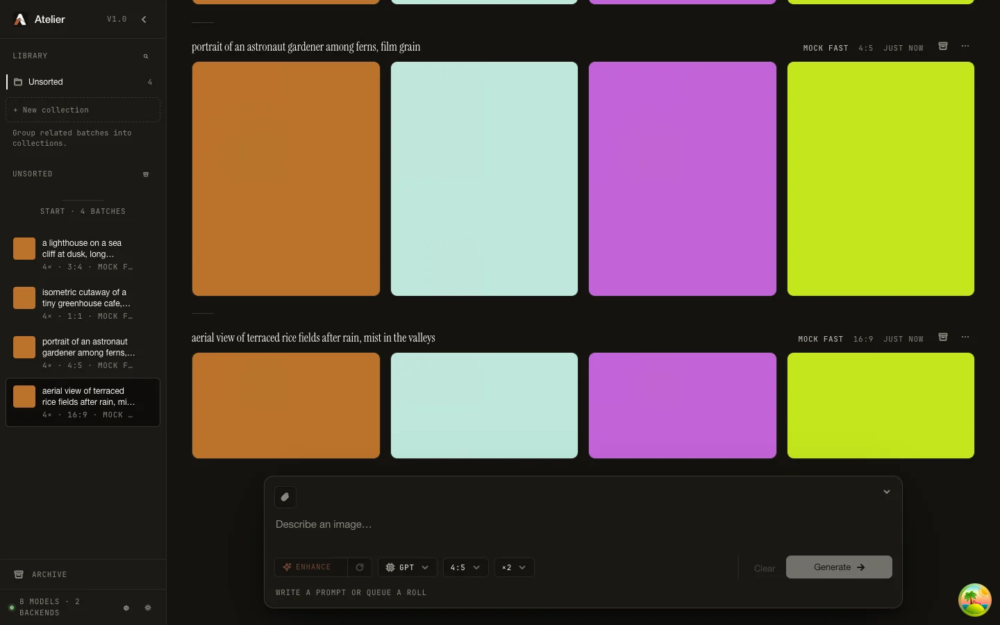

<p align="center">
  
</p>

<h1 align="center">Atelier</h1>

<p align="center">
  <strong>One prompt box. Many backends. Your images stay yours.</strong><br>
  Cloud, bring-your-own-key and local ComfyUI image and video models behind a single self-hosted interface.
</p>

<p align="center">
  <a href="LICENSE"></a>
  
  
  
</p>

<p align="center">
  <a href="docs/getting-started.md"><strong>Get started</strong></a> ·
  <a href="#set-up-with-your-ai-agent">Set up with AI</a> ·
  <a href="docs/deployment.md">Deploy a server</a> ·
  <a href="docs/user-guide.md">User guide</a> ·
  <a href="docs/admin-guide.md">Admin guide</a> ·
  <a href="#sister-project-ephemera">Sister project: Ephemera</a>
</p>

<p align="center">
  
</p>

---

Atelier is a self-hosted web app for AI image and video generation. You pick a
model, write a prompt and get a batch of tiles; the server routes the request
to the right backend, streams previews as they render and keeps every batch in
server-side history. It sits behind your own authentication proxy and keeps
each user's work separate, down to the encryption of every stored file.

## Start here

| Your goal | Follow this guide |
|---|---|
| Try the interface without API keys or a GPU | [Getting started](docs/getting-started.md): download, install and generate a test image |
| Run a server with real models and authenticated users | [Deployment](docs/deployment.md): prerequisites, encryption, first launch and maintenance |
| Learn the everyday workflow | [Using Atelier](docs/user-guide.md): models, references, collections and templates |
| Become an admin and finish the setup | [Admin guide](docs/admin-guide.md): where the admin panel is, what you must configure and what is optional |
| Turn on Enhance, AI fill and Brainstorm | [Connect a text model](docs/connect-a-text-model.md): Ollama, LM Studio, OpenAI, Anthropic, OpenRouter and other compatible servers |

The public repository contains the application, Docker builds, proxy examples
and the ComfyUI worker. No private repository or operator-specific overlay is
needed. You supply your own model service or provider keys, and production
hosting needs an authentication proxy. Model weights and provider access are
not included.

The local walkthrough uses **Mock Fast**, which produces small coloured test
images so you can check the installation without spending provider credits.
It then explains how to connect real generation. For a shared or public
installation, follow the production guide before exposing the app.

Image generation works as soon as a backend is connected. The text features
need one more step in the app: an admin connects a text model and picks a
default. The [Admin guide](docs/admin-guide.md) covers it in five steps.

## Set up with your AI agent

Prefer to have Codex or Claude Code handle the installation? Copy this prompt
into your agent with terminal access on the computer where you want to run
Atelier. It follows the same setup guide, checks the local installation and
helps connect your chosen provider.

```text
Set up https://github.com/SneakyShadyLurker/atelier-studio locally. Reuse a
matching checkout or clone it. Read docs/getting-started.md and follow it with
the pinned Bun version, preserving existing configuration and data. Keep the
installation on loopback. Start the API, local sign-in proxy and web app;
verify Mock Fast generation, saved history and a downloaded PNG. Then ask
which real provider I want, configure it using secure credential entry and
verify a real image when access is available. Ask before setting up a
shared/public server, following docs/deployment.md. Finish with the app URL,
start/stop commands, verification results and any remaining requirements.
Distinguish mock checks from real-provider verification.
```

You supply provider access or model weights. The local trial needs neither.
For a manual walkthrough, open [Getting started](docs/getting-started.md).

## Highlights

### ✦ One prompt box, every backend
GPT Image through a CLIProxyAPI-compatible upstream, Google Gemini with each
user's own key, and local Krea 2 and MOSS models on ComfyUI share one composer,
one model menu and one history. Partial previews
stream over SSE, batches queue when a pool is busy, and in-flight tiles can be
canceled.

### ✦ Prompt Library
Reusable templates, weighted variable lists and tag dimensions that keep random
picks coherent. `{{ai-fill: …}}` blanks let a text model fill parts of a prompt
at generate time while your own text stays byte for byte, and Brainstorm
streams fresh character concepts into the roll queue. Enhance rewrites a prompt
for the selected model in one click. These features run on text models an
admin connects in the app, such as a local Ollama or LM Studio, OpenAI,
Anthropic or OpenRouter ([Admin guide](docs/admin-guide.md)). Each person can
pick their own model per task.

### ✦ Local models as data
Each local model is a manifest and its ComfyUI graphs, validated at startup and
extendable from a mounted directory without rebuilding the image. Generation
runs through a hardened ComfyUI worker: bearer-token TLS on every route,
per-job leases, a node allowlist and in-memory inputs and outputs.

### ✦ Video, Extend and AI Storytelling
MiniMax H3 turns a still or a text prompt into a clip with native audio.
Extend continues a clip from its last frames and soundtrack and stitches the
sequence, and AI Storytelling plans an outline into segments and renders them
one after another. The bundled H3 graphs follow ComfyUI's official templates
and ship disabled until you verify them against your own ComfyUI.

### ✦ Encrypted at rest, per user
Every stored artifact is an age file encrypted to its owner, and the server
starts sealed until it receives the root identity. Provider keys are encrypted
separately. Prompts and other metadata in SQLite rely on the encryption of the
volume they live on.

## Also included

- **Reference images**: attach up to 4 (GPT) or 10 (Gemini); HEIC, AVIF, GIF
  and TIFF are converted on the server, and Krea rows take a face reference
- **Collections and archive**: drag batches into collections, pin favourites,
  search prompts, and restore archived work for 30 days
- **Gemini BYOK**: each user brings their own Google key, encrypted on the server
- **Ephemera character cards**: turn a finished image into a character card in
  [Ephemera](#sister-project-ephemera)
- **Polish**: light and dark themes, a lightbox with zoom, keyboard shortcuts,
  and layouts built for phones, tablets and desktops

## Sister project: Ephemera

**[Ephemera](https://github.com/SneakyShadyLurker/ephemera)** is a self-hosted
roleplay chat from the same author, also AGPL and built on Bun. Your
characters, personas and lorebooks are saved and encrypted per user, and every
conversation vanishes when you close the tab. It imports SillyTavern cards and
writes new ones with AI.

The two apps run independently and work well together:

- **Image to card**: an optional action on a finished Atelier image sends it to
  Ephemera, which writes a character card from it
  ([setup](docs/deployment.md#ephemera-character-cards-optional),
  [how it works](docs/providers.md#ephemera-character-cards))
- **Pictures in chat**: Ephemera can use Atelier as its image backend for
  portraits and scene pictures

Neither app needs the other.

## Documentation

[Getting started](docs/getting-started.md) · [Using Atelier](docs/user-guide.md) ·
[Admin guide](docs/admin-guide.md) · [Connect a text model](docs/connect-a-text-model.md) ·
[Architecture](docs/architecture.md) · [Deployment](docs/deployment.md) ·
[Providers](docs/providers.md) · [Local models](docs/local-models.md) ·
[Prompt Library authoring](docs/prompt-library-authoring.md) ·
[Web conventions](docs/web-conventions.md) · [All docs](docs/README.md)

## License

[GNU AGPL v3.0 only](LICENSE). For use without the AGPL obligations, open an
issue titled Commercial license. Issues are welcome; pull requests are not
accepted at this time. Atelier is meant for adults; operators decide who they
admit.
