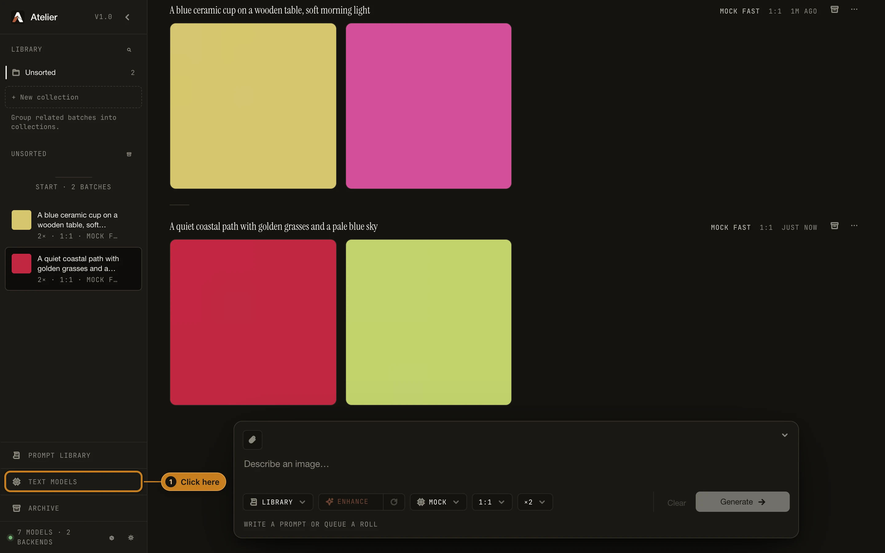
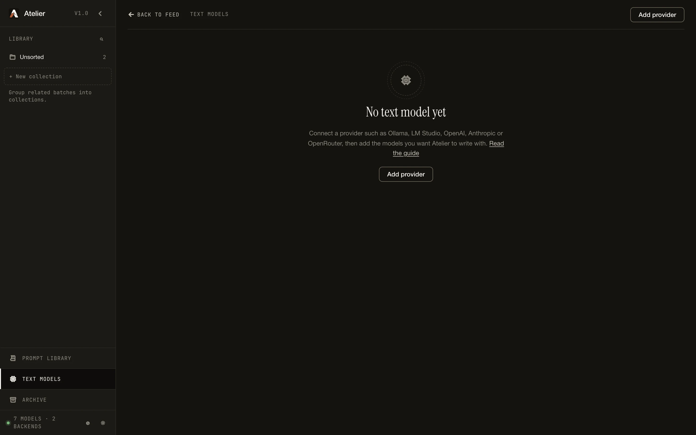

# Admin guide

Atelier has one admin role: managing the **text models** that power Enhance,
AI fill, Brainstorm, story planning and the other features that write words.
This guide shows how to become an admin, where the admin panel is, and what
you must set up so every feature works.

Image generation does not need an admin. Server settings such as image
backends, encryption and who may use what live in the server's environment
file, which the person running the server (the operator) edits. On a small
installation that is usually you as well. Those settings are summarised in
[Server settings outside the app](#server-settings-outside-the-app).

## At a glance

| Step | Where | Needed for |
|---|---|---|
| [Make yourself an admin](#1-make-yourself-an-admin) | Environment file | Seeing the admin panel at all |
| [Open the admin panel](#2-open-the-admin-panel) | Sidebar, **Text models** | Everything below |
| [Connect a provider and add models](#3-connect-a-text-model) | Text models view | Every text feature |
| [Set a default model](#4-set-a-default-model) | **Routing** panel | Every text feature. Adding models alone does not choose one |
| [Fine-tune](#5-optional-fine-tuning) | **Routing** panel and **Edit model** | Optional |

## 1. Make yourself an admin

Admins are listed by username in the API's environment file: `api/.env` for a
local install, `infra/docker/.env` for Docker.

```dotenv
TEXT_PROVIDER_ADMINS=alice,bob
```

- Use the exact usernames your sign-in proxy sends. Matching is
  case-sensitive, so `Alice` and `alice` are different people.
- Separate several admins with commas. Spaces around names are ignored.
- Empty or unset means nobody is an admin. There is no wildcard.
- Restart the API after any change. For Docker, recreate the container so it
  reads the new file.

To store API keys for cloud providers, the server also needs
`BYOK_ENCRYPTION_KEY`. Production installs already require it. Generate it
once with `openssl rand -hex 32` and keep it safe: if it changes, saved keys
can no longer be read. Local providers such as Ollama and LM Studio work
without it.

## 2. Open the admin panel

Sign in as one of the admins. A **Text models** row appears near the bottom
of the left sidebar, between **Prompt Library** and **Archive**. Click it.



- **Sidebar collapsed?** Click **Expand sidebar** at the top left first.
- **On a phone**, tap the menu button at the top left (**Open menu**), then
  **Text models**.
- **Row missing?** Your username is not in `TEXT_PROVIDER_ADMINS` exactly as
  written, or the API was not restarted. People who are not admins never see
  this row, and the admin pages answer them with "not found".

The cog at the bottom of the sidebar opens **API keys**. That is each
person's own Google key for Gemini, not an admin setting.

On a fresh installation, the Text models view is empty:



Click **Back to feed** at the top to return to your images.

## 3. Connect a text model

A **provider** is the server that runs the models: Ollama or LM Studio on
your own hardware, or a cloud service such as OpenAI, Anthropic or
OpenRouter. A **model** is one model on that provider. You can connect as
many of each as you like.

1. Click **Add provider** and choose a preset. Atelier fills in the address
   for you.
2. For a cloud provider, paste its API key. Atelier encrypts it and never
   shows it again. The four characters shown next to the provider afterwards
   are a fingerprint for telling keys apart, not the end of the key.
3. Click **Test connection**, then **Save provider**.
4. In the dialog that opens next, tick the models you want and click
   **Add** (the button counts them, for example **Add 2 models**).
5. Click **Untested** on a new model's row to run the four quick checks
   (plain reply, JSON output, image input, reasoning). Then click
   **Apply findings** and **Save**.

If Atelier runs in Docker and the model runs on the same computer, replace
`localhost` in the address with `host.docker.internal` or the computer's LAN
address. [Connect a text model](connect-a-text-model.md) walks through every
preset, the Docker networking rules and each model setting.

## 4. Set a default model

This is the step people most often miss. Adding models does not choose one
for anybody. Until you set a default, text features work only for people who
pick their own model in their settings.

In the **Routing** panel beside your providers (below them in a narrow
window), pick a **Default model**. That one choice switches on every text
feature for everyone. The default is the fallback: Atelier uses it whenever
nothing more specific applies, such as a task assignment or a person's own
pick.

Pick a model that passed the **Image input** check if people attach
reference images to Enhance or the video motion writer. Then try **Enhance**
on a real prompt to confirm the result reads well.

| If this is missing | People see |
|---|---|
| No default model, or it is switched off, and nothing more specific applies | "No text model is set up" on Enhance, AI fill, Brainstorm and the other text actions |
| No routed model can read images | "None of the available text models accepts images" when references are attached |
| `BYOK_ENCRYPTION_KEY` unset | Image generation still works. Saving a provider with an API key fails, and the key field is disabled with an explanation |

Two features keep working without a text model: Krea prompt condensing and
automatic video motion rewriting fall back to the original text.

## 5. Optional fine-tuning

Everything here is optional. One default model is a complete setup.

| Setting | What it does |
|---|---|
| **Task assignments** | Give one task its own model, for example a fast model for AI fill and a stronger one for Brainstorm. **Use default** clears it |
| **Prompt writers** | Choose which model writes prompts for one image model. **Always use this model** overrides everyone's own pick and never falls back: if that model is off, requests for that image model fail. **Use unless the person picked their own** lets personal picks win and falls back normally |
| **Model switch** | Turns a model off without deleting it. Atelier skips it and uses the next model in line, except where it is a locked prompt writer |
| **Slow model** | Allows longer waits and larger replies, for models that think for minutes |
| **Screen requests first** | Checks request text before it reaches that model. It blocks explicit nudity (even of adults), sexual content involving minors or people whose age is not clearly adult, and graphic violence. Needs `OPENROUTER_API_KEY` on the server |

People can also pick their own model per task under **Prompt Library**,
**Settings**. Before you remove a model or provider, Atelier tells you what
depends on it, including how many people picked it. Those uses fall back to
the next model in line. [Choose which model writes what](connect-a-text-model.md#choose-which-model-writes-what)
explains the exact order Atelier follows.

## Keeping it healthy

- **Status labels.** Each model shows **available**, **offline** or
  **unknown**. Atelier rechecks every minute, and **Check again** in the
  provider's header rechecks now. Offline models are skipped automatically,
  except a locked prompt writer, which Atelier still tries.
- **Changing a key.** Open the provider with the pencil next to its name,
  then use **Replace key**.
- **New models.** Click **Add models** in a provider's header, then test and
  enable them.

## Server settings outside the app

These are set in the environment file and take effect after an API restart.
The admin panel cannot change them.

| Setting | Purpose | Details |
|---|---|---|
| `TEXT_PROVIDER_ADMINS` | Who sees the Text models view | [Above](#1-make-yourself-an-admin) |
| `PROMPT_LIBRARY_USERS` | Who gets the Prompt Library, including templates, AI fill, Brainstorm and personal model picks | [Deployment](deployment.md#3-configure-the-environment) |
| `LOCAL_MODELS_USERS` | Who may use local ComfyUI image and video models | [Deployment](deployment.md#3-configure-the-environment) |
| `EPHEMERA_USERS` | Who may turn images into Ephemera character cards | [Deployment](deployment.md#ephemera-character-cards-optional) |
| `BYOK_ENCRYPTION_KEY` | Encrypts stored provider keys and personal Google keys | [Deployment](deployment.md#3-configure-the-environment) |
| `OPENROUTER_API_KEY` | Required for GPT Image and for screened text models | [Providers](providers.md#gpt-only-input-moderation) |
| `CLIPROXY_BASE_URL`, `CLIPROXY_TOKEN` | GPT Image upstream | [Getting started](getting-started.md#connect-a-real-model) |
| `COMFYUI_*` | Local model worker connection | [Local models](local-models.md) |

Every list above takes comma-separated usernames, is case-sensitive and
defaults to nobody. The lists are independent: being a text-model admin
grants nothing else.

## Troubleshooting

| Problem | Fix |
|---|---|
| No **Text models** row | Add your exact username to `TEXT_PROVIDER_ADMINS` and restart the API |
| "Could not reach the server" | Check the address and port. Under Docker, replace `localhost` |
| "The server refused the key (401)" | Check the key's access and credit, then **Replace key** |
| Text actions say "No text model is set up" | Set a **Default model** in **Routing** and make sure it and its provider are switched on |

The full table is in [Connect a text model](connect-a-text-model.md#troubleshooting).
