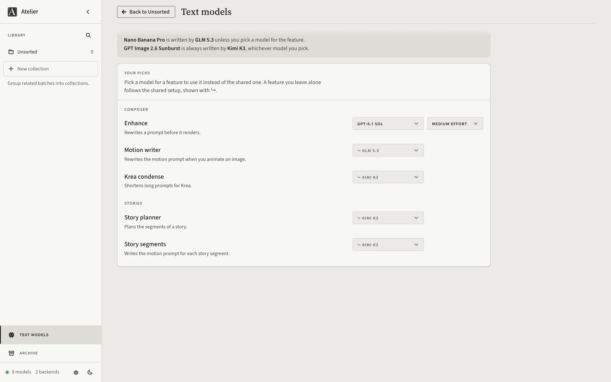

# Using Atelier

Atelier keeps your generations in server-side history, scoped to your signed-in
username. If you have not installed it yet, start with [Getting started](getting-started.md)
or [Deployment](deployment.md).

## Generate your first image

1. Select a model with the model chip in the composer at the bottom of the
   screen. The chip shows a short family name, such as `GPT`, `Banana` or
   `Mock`; hover it for the full model name. The menu groups the models
   available on this installation into Local and Cloud, and marks models that
   need your own key with a lock and **Needs your API key**.
2. Enter a prompt describing the picture you want.
3. Choose an aspect ratio with the ratio chip (for example `1:1`) and the number
   of images with the count chip (`×1` to `×4`). The available choices depend
   on the model. MiniMax H3 Image renders one image per roll, because the
   model's ComfyUI implementation supports batch size 1 only; press Generate
   again for more variations. Leave its steps at the default 6 in Prompt
   Library → Settings → Model steps: the model is distilled for exactly that
   count.
4. Press **Generate**, or **Cmd+Enter** on macOS / **Ctrl+Enter** elsewhere while
   editing the prompt. Each press queues one more batch, so press it as many
   times as you want variations; there is no need to wait for the last one.
   Once your waiting batches reach the server's limit (60 by default), further
   presses wait in the roll queue and start as capacity frees; **Stop** appears
   beside Generate while that queue drains. **Enhance**, beside Generate (or
   **Shift+Cmd+Enter** / **Shift+Ctrl+Enter**), generates from a text model's
   rewrite of the prompt instead; see Prompt Library below.
5. Watch the tiles. Some providers stream previews; others return only the
   finished image. A queued batch waits for capacity. Local models show the
   sampler step (for example `12/25`) and, after a few steps, the estimated
   time left. Models with a second refining pass show `Refine 3/8` for it, and
   `Finishing` means sampling is done and the image is being saved. Cloud
   providers report no steps, so their tiles show the elapsed time instead.

Atelier remembers your model, ratio and count for your account in this browser,
so they are still selected after a reload. When nothing is remembered, it opens
on a model you can use without adding a key.

Choose **Mock Fast** only when testing a development installation. Its small
solid-colour images do not reflect your prompt.

For Gemini, open **API keys** at the bottom of the sidebar and save your own
Google key first. If the dialog reports that BYOK is not configured, the server
operator needs to set `BYOK_ENCRYPTION_KEY`. Provider credits and quotas belong
to the configured service or your own key.

Text features such as **Enhance** need a text model, which an admin connects
in the **Text models** view, listed in the sidebar below **Prompt Library**
for admins. If they answer "No text model is set up", ask
your operator, or follow [Connect a text model](connect-a-text-model.md) if
you run the server yourself.

## Open, download and reuse results

Click a finished tile to open the lightbox. Use the arrows to move between
images in the batch and **Escape** to close it. You can zoom an image and
download the finished file. A download is a decrypted copy on your computer;
keep it somewhere appropriate for its contents.

**Edit from this image** puts a finished image into a new reference-based
request when an editing model is available. It leaves the original result in
history. Change the prompt and generate again to create a new batch.

On a desktop, the composer tucks itself into its bar when you click a batch or
scroll the feed, or after a few seconds of not touching it while images are
generating, so your results get the whole view. Your prompt, references and
queue stay as they are, and the bar keeps **Generate**. Click the bar, press
Enter, or start typing while the bar is focused to bring it back.

The feed keeps your place. New results appear at the bottom, and the view
follows them only while you are already there. When you scroll more than a
screen above your newest results, a **Jump to latest** button appears above the
composer, with a dot when a batch arrived or finished below. A batch started on
another device shows up within about a minute while the tab is visible. If a
refresh fails, a "Couldn’t refresh" row with **Retry** appears at the bottom of
the feed; the results you already have stay on screen. A queued batch is
announced as queued until it starts generating. Video clips play when most of
the clip is on screen (touch) or under the pointer, and pause while the viewer
is open. An empty **Pinned** view says "Nothing pinned yet" and an empty
collection says "This collection is empty".

Refresh the page to reconnect to server history. Closing the browser is not a
cancel operation; use the batch's cancel control when you want to stop work.

## Work with reference images

Attach a reference in the composer, then write what you want the model to do
with it. The selected model determines the reference count and supported
workflow: GPT accepts up to four, Gemini up to ten, the bundled Krea
reference graph uses one face reference, and MiniMax H3 Image takes up to
three pictures. MOSS does not accept references.

On **MiniMax H3 Image** the pictures are numbered in the order you attached
them, and the prompt can name them `<Picture 1>`, `<Picture 2>` and
`<Picture 3>`. Use it to edit a picture ("remove the newspaper"), to put the
person from one picture into a new scene, or to combine a person, a place and
a garment from three pictures. Enhance generates from a rewrite of your
request in the form the model follows best, and a short instruction is rewritten the same way
automatically before it renders when a text model that accepts images is
available. By default every MiniMax H3 Image result is delivered with a 2048
pixel long edge: without pictures the model renders at about 16 megapixels and the
result is reduced from that, with pictures it renders at about 4.
You can change both sizes in Prompt Library → Settings → Render resolution:
pick 4, 8 or 16 MP for Text to image and for With reference pictures. A
larger size takes longer; the delivered image stays 2048 pixels on the long
edge while Downsize to 2K is on. With pictures, 4 and 8 MP give clean results; 16 MP is available but
tends to come out harsh and over-sharpened. Turn off Downsize to 2K in the
same row to keep the image at the size it was rendered: at the default 16 MP
that is a PNG of roughly 20 to 34 MB. Reset turns it back on.

Reference uploads are kept with your user data. Removing a reference from the
current prompt changes the next request; it does not rewrite a completed batch.
Use the app's upload controls for removing stored uploads rather than editing
files in `DATA_DIR`.

## Organise your work

The **Library** sidebar contains your collections, **Unsorted** work and
**Pinned** batches. Create a collection with **New collection**, then use
**Move to collection** on a batch to file it. Pin a batch to make it easier to find, and use search to look
for prompt text.

Each batch header has **Re-roll**, **Move to collection** and **Archive batch**
actions. **Copy prompt** is beside them on larger screens and under **More** on
phones. A long prompt is cut off in the header: open the batch's **More** (⋯)
menu and choose **Show full prompt** to read all of it, then press Escape or
click elsewhere to close it. Nothing opens when you rest the pointer on a
prompt. In the Archive the same action sits on the tile beside **Restore**. To create a destination while moving a batch, choose **New collection**,
enter its name, then select **Move** or press Enter.

Archiving removes work from the active views. Open **Archive** to restore
archived results, or delete them permanently. Archived work is retained for
30 days before expiry; permanent deletion and **Empty archive** cannot be
undone. Download anything you want to keep before permanently deleting it.

Atelier tabs open in the same browser stay in step: a batch you generate,
archive, move, pin or cancel in one tab shows up in the others without a
reload. Other browsers and devices catch up when you return to them.

Your history lives on the server. Changing browser, or clearing browser storage,
does not delete it. Signing in under a different username gives you a different
history; the server does not merge usernames automatically.

## Prompt Library and text assistance

The operator enables **Prompt Library** for selected users. If it is missing,
ask the operator to add your exact signed-in username to `PROMPT_LIBRARY_USERS`.
New installations do not include the operator's personal Prompt Library.

- **Templates** hold reusable prompt text.
- **Variable lists** provide alternatives for parts of a template.
- **Dimensions** group tags that keep related choices coherent.
- **Settings** holds the Model steps, Render resolution and Prompt condensing
  options. Which text model writes for you is under **Text models** in the
  sidebar (see below).

Start with a simple reusable template, then add variables as you need them.
The **Library** chip in the composer opens the picker. A roll queue lets
you prepare multiple prompts before generating them.

Reordering templates, variable lists or dimensions keeps the current editor
open, including its unsaved draft.

**Draft Template** in the template editor asks a text model to write the body.
On an empty template it asks what to draft, such as the subject, mood and
style, and the draft fills the body. On a template that already has a body it
asks what to change. The text model proposes edits to the passages your
instructions touch, and everything else, your tokens included, stays as
written.

The proposed edits open as a review in place of the body. Text the model
added is underlined on a tinted background; text it would remove is struck
through. Each edit carries a small number that matches a note row below it,
with the reason for the edit and a **Reject** button. A rewrite of a long
passage shows the passage under **Removed** and the new text under
**Proposed**. Long stretches the model left alone fold behind **Show N
unchanged words**. Every edit starts accepted: **Reject** turns an edit off
and **Accept** turns it back on, and nothing moves on the page when you
decide. **Reject all** and **Accept all** above the text decide every edit at
once. **Previous** and **Next** step through the edits, with a count such as
"2 / 4" between them. On a keyboard, **J** and **K** move to the next and
previous edit, **A** accepts and **R** rejects the current edit and moves on,
and **Cmd+Enter** on macOS / **Ctrl+Enter** elsewhere applies.

**Apply N changes** writes the accepted edits into the body; **Discard** leaves
the body as it was. Both show a message with **Undo**, which brings the review
back with your decisions, as long as you have not edited the body since.
**Rework again** opens the dialog with your last instructions and replaces the
review with the new answer. When the model suggested an edit it could not line
up with the template text, the review lists it under "1 suggestion could not
be placed" with the reason. If the model finds nothing to change, the dialog
stays open with its note and your instructions. Applying does not save the
template: nothing is saved until you press **Save template**.

The dialog also shows the **Model** and
**Reasoning** level that write the draft. They are your **Template drafts**
pick under **Text models**, **Your picks**, so a change made in the dialog
stays for later drafts and shows there too.
If an admin locked the prompt writer for the image model selected in the
Composer, the dialog names that model instead and there is nothing to pick.

**Draft List** in the variable list editor does the same for a list's
options. On an empty list it asks what the list should hold and fills the
rows. On a list that already has options the dialog offers two choices:

- **Add options** adds new options in the vein of the ones you have. Say what
  to add, such as "15 more, leaning toward winter", or leave the field blank
  for more of the same. It never changes or removes an existing option.
- **Rework** changes the list the way you describe: rewrite options, remove
  some, change how often one is drawn, or add new ones. Options you do not
  mention stay as they are.

Either way the answer opens as a review in place of the option list. An
edited option shows its removed words struck through and its new words
underlined on a tinted background; a removed option is struck through; added
options sit at the end, marked the same way as new words. A changed weight
reads "weight 1 to 5". Each change has a number, the model's reason where it
gave one, and a **Reject** button; long runs of untouched options fold behind
**Show N unchanged options**. Deciding, stepping through the changes, the
keyboard shortcuts, **Apply N changes**, **Discard**, **Undo** and **Rework
again** work as in the template review. When the model proposed a change it
could not match to an option, the review lists it under "1 suggestion could
not be placed". Applying does not save the list: the options are saved when
you press **Save list**. A reworked option keeps its tags; added options
start without tags. A weight the review changed is saved with the list too:
only a weight you type yourself is saved straight away, and if that save
fails the field goes back to what it showed before, with a message.

**Draft New List** in the Lists pane makes a whole list from a description,
such as "twenty weather conditions, from clear to stormy". The text model
names the list and writes its options. The list is created right away and
its options stay unsaved until you press **Save list**.

These dialogs show the **Model** and **Reasoning** fields too; they are your
**List drafts** pick.

**Enhance** asks a text model to rewrite the prompt and generates from the
rewrite. Every press rolls the prompt's tokens afresh, rewrites that result and
starts one batch, so you can press it repeatedly without waiting; the prompt
itself, including any `{{var::…}}` lists, stays as you wrote it. It fires the
prompt in the Composer only: rolls waiting in the queue stay there for
**Generate**. The rewrite
that rendered is the batch's prompt: use **Copy prompt** on the batch to keep
it. **Shift+Cmd+Enter** on macOS / **Shift+Ctrl+Enter** elsewhere presses
Enhance from the prompt. **Brainstorm** produces ideas
for the queue, and `{{ai-fill: instruction}}` asks a text model to fill a part
of a template at generation time. These actions need a text model connected by
an admin. A working image provider or local GPU alone does not provide one.

Once a text model is connected, **Text models** appears in the sidebar. Its
**Your picks** page (a tab of that name for admins) lists each feature with a
model menu, grouped under **Composer**, **Stories** and, if you have the
Prompt Library, **Prompt Library**. A feature you leave alone follows the
shared setup your admin chose: its chip shows the model it uses after a ↳,
and **Shared setup (…)** in the menu, with that model's name, brings a
feature back to it. Pick another model to use it for that feature, then
choose a reasoning effort if the model offers levels: the chip reads
**Default effort** until you do, and models without levels show "Effort fixed
by the model". A model that is offline right now cannot be picked, and if
your pick goes offline, the feature uses the shared setup until it is back.

An admin can also choose a text model to write the prompts for a particular
image model. A note above your picks names each one. If it is always used,
your pick does not apply to that image model and the result can come from a
different model than the one you chose. Otherwise your pick still wins.

On **MiniMax H3 Image** and **MOSS**, a prompt under 60 words is expanded
automatically before it renders, because those models draw very short prompts
poorly. The batch then shows the expanded prompt. A prompt of 60 words or more
is sent as written, so write a fuller prompt, or press **Enhance**, copy the
batch's prompt and edit it, to keep full control. An operator can switch the
expansion off for either model.

On **Krea** models, a prompt over 270 words is shortened automatically before
it renders, toward about 200 words (more when it describes several people), because long prompts that list
many objects flatten Krea's lighting. The batch then shows the shortened
prompt. To always send your prompt as written, turn off **Condense long
prompts** in Prompt Library → Settings → Prompt condensing.

Read [Prompt Library authoring](prompt-library-authoring.md) for syntax,
weights, dimensions and worked examples.

## Video, Extend and stories

These features appear only when the installation has suitable local models and
the operator has enabled them. The bundled MiniMax H3 video graphs are disabled
templates and are unverified on a live host; the operator must validate them
before use. MiniMax H3 Image is a separate still-image model and is not part of
these features.

For image-to-video, choose **Animate this image** on a finished still, or select
an image-to-video model and supply a source still. Describe the movement in the
**Motion prompt**, choose an offered duration and press **Animate**. A
text-to-video model starts from text without a still.

**Extend this video** continues a supported clip; Atelier can stitch the
segments into a sequence master for download. AI Storytelling plans and renders
connected segments. Video jobs may take much longer than image jobs. An
offline model or a template that has not been enabled is an operator setup
issue, not a prompt problem. The [local model guide](local-models.md) explains
the requirements.

The optional Ephemera character-card action also needs operator configuration
and a separate Ephemera installation. See [the integration setup](deployment.md#ephemera-character-cards-optional).

## Understand errors and missing features

| What you see | What to do |
|---|---|
| A model is offline | Ask the operator to check the model host, required weights and worker readiness |
| A key or quota error | Check the relevant provider account, access and credits; retry after the stated delay |
| GPT input check unavailable | Ask the operator to check OpenRouter configuration; Atelier blocks GPT requests while the check is unavailable |
| Images cannot be read after a server restart | Ask the operator to check whether encrypted storage has been unsealed |
| Missing local models or Prompt Library | Check the user allowlists with the operator |
| Your history seems empty | Confirm that you are using the same server and signed-in username |

For an issue report, include what you tried, the model name and the visible
error. Do not post API keys, private prompts, images or a populated `.env`.
Operators can find the maintenance commands in [Deployment](deployment.md#day-to-day-operation).
